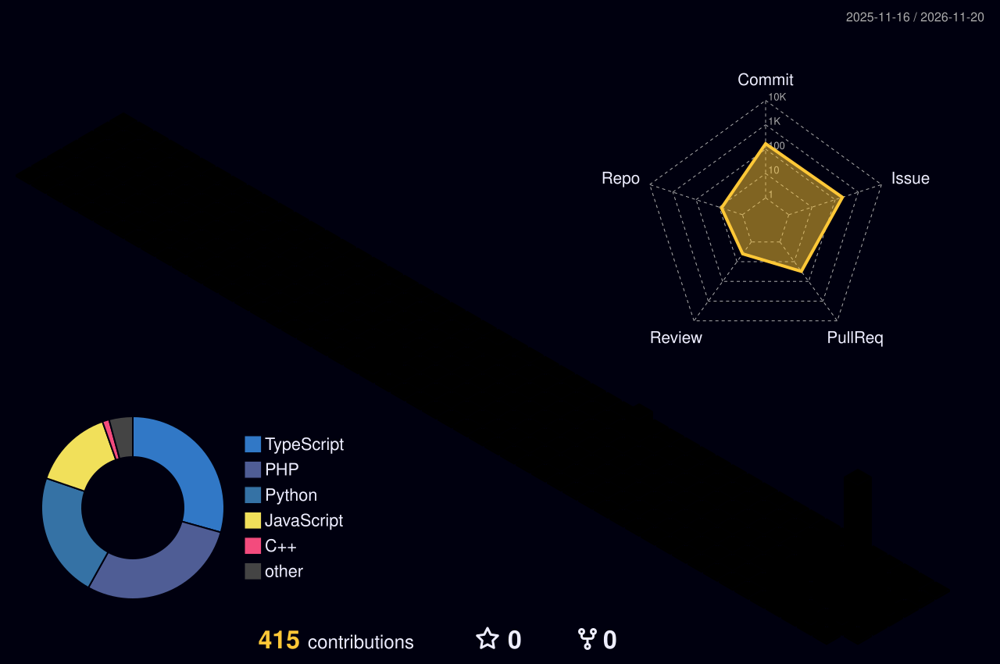

<!-- Banner -->

  

  

  

---

## 👨‍💻 About me

- 🎓 4th-year student at **Transilvania University of Brașov**
- 🛠️ I build full-stack apps — web, mobile and backend services
- 🤝 Used to working in teams — project manager and backend developer on university projects
- 📝 Currently working on my bachelor's thesis
- 🌱 Currently exploring microservices with **Spring Boot**, **Docker** and **React**
- 📍 Based in **Brașov, Romania**

## 🧰 Tech stack

  
    
  

## ⭐ Flagship project

<!-- Thesis: replace this block with the real project once the repository exists -->
<table align="center">
  <tr>
    <td align="center" width="820">
      
       
      
      
<b>Coming soon.</b> Description, demo and code will be published here.

    </td>
  </tr>
</table>

## 🚀 Top projects

<table>
  <tr>
    <td width="50%" valign="top">
      
      
Live auction platform with virtual coins: real-time bidding over WebSockets, fund reservation, anti-sniping and automatic closing. Spring Boot microservices behind a JWT API gateway.

      
<b>My role:</b> project manager · user-service &amp; api-gateway

      
      
      
      
      
    </td>
    <td width="50%" valign="top">
      
      
To-do app for individuals and groups sharing tasks, synced in real time across web, Android and iOS.

      
<b>My role:</b> project manager · backend — Supabase schema, Row Level Security, sync

      
      
      
      
      
    </td>
  </tr>
  <tr>
    <td width="50%" valign="top">
      
      
Client-server app that processes academic PDFs (study plans, course sheets): text extraction, OCR fallback for scans, automatic field parsing and a React dashboard.

      
      
      
      
    </td>
    <td width="50%" valign="top">
      
      
Looks up any IP or domain: location on a map, time zone with live local time, ISP and search history. Vanilla JS page, React web app and React Native mobile app.

      
      
      
      
    </td>
  </tr>
</table>

## 📦 More repositories

  
  
  

## 📊 GitHub stats

<!-- 3D contribution graph, regenerated daily by .github/workflows/profile-3d.yml -->

  

  
  

  

## 📫 Get in touch

  <!-- Add more contact buttons here, e.g. LinkedIn:
  
  -->
  

  

